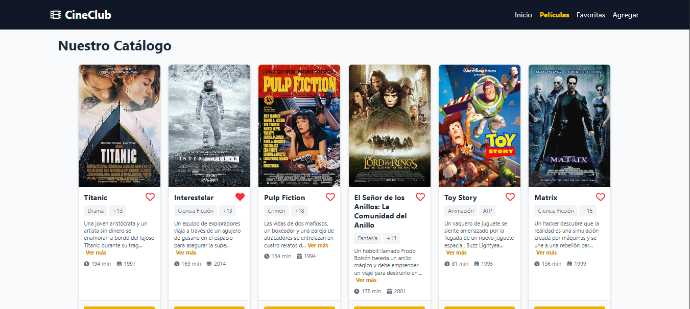
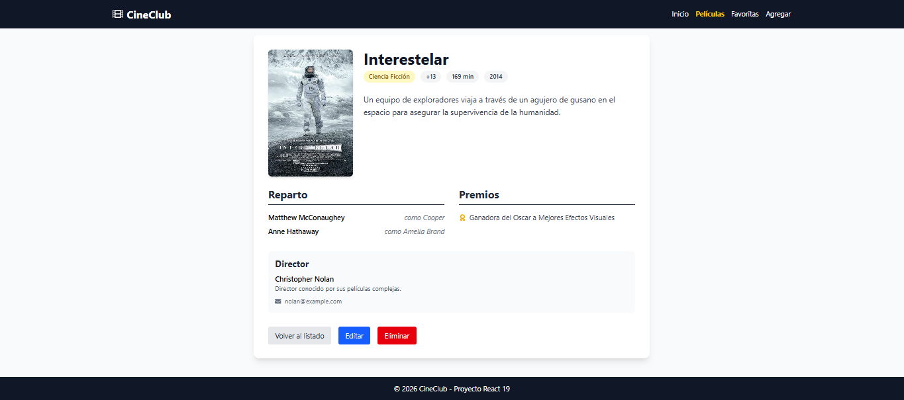
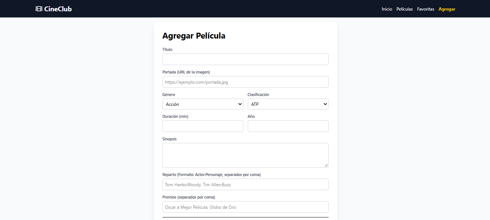

# 🎬 CineClub

CineClub es un catálogo personal de películas hecho con React 19. Permite ver el listado de películas, consultar el detalle de cada una (reparto, premios y director), agregar, editar y eliminar películas, y marcar favoritas. Los datos se guardan en una API REST simulada con json-server.

**Tecnologías:** React 19 · Vite · Tailwind CSS 4 (`@tailwindcss/vite`) · React Router 7 · json-server · react-toastify · react-icons · react-spinners


---

## 🚀 Instalación y ejecución

### Requisitos previos
- [Node.js](https://nodejs.org/) 18 o superior
- npm (viene con Node.js)

### Pasos

1. Clonar el repositorio:
   ```bash
   git clone https://github.com/TU_USUARIO/cineclub.git
   cd cineclub
   ```

2. Instalar las dependencias:
   ```bash
   npm install
   ```

3. Iniciar la API en una terminal:
   ```bash
   npm run server
   ```
   La API queda en `http://localhost:5000/movies`.

4. Iniciar la aplicación en otra terminal:
   ```bash
   npm run dev
   ```
   La app queda en `http://localhost:3000`.

5. Abrir `http://localhost:3000` en el navegador.

> ⚠️ Las dos terminales deben estar abiertas al mismo tiempo. Sin la API, el catálogo muestra un mensaje de error.

### Otros comandos
```bash
npm run lint    # revisa el código
npm run build   # genera la versión de producción en dist/
```

---

## ✅ Requisitos implementados

Leyenda: ✅ cumplido · ⚠️ parcial · ❌ no implementado

### Núcleo (obligatorio)


### Intermedio


### Reto React 19 


---

## 🧠 Decisiones técnicas


### Cómo manejé las favoritas
Elegí guardar el campo **`favorite` en `db.json` y cambiarlo con PATCH**, en lugar de usar `localStorage`. Las razones:
- **Persisten en el servidor:** se ven igual en cualquier navegador o computador, no solo en el mío.
- **Una sola fuente de verdad:** la película ya trae su estado de favorita, así que no hay que cruzar una lista de ids guardada aparte.
- **PATCH en lugar de PUT:** solo se envía `{ favorite: true/false }` y no el objeto completo, así no hay riesgo de sobrescribir otros campos.

En `Movies.jsx` el corazón usa una **actualización optimista hecha a mano**: el cambio se ve al instante y, si el PATCH falla, se revierte y aparece un toast de error. La página **Favoritas** pide la lista y la filtra con `filter(m => m.favorite)`.

### Retos de React 19
Todavía no he implementado ninguno de los retos RT-01 a RT-06.
<!-- Cuando los hagas, escribe aquí cuáles elegiste y por qué -->


---

## 🛠️ Problemas encontrados y cómo los resolví

1. **Al editar una película se perdían datos (favorita y fecha de creación).**
   El formulario solo envía los campos editables, y PUT reemplaza el objeto completo.
   **Solución:** en `EditMovie.jsx` combino la película original con los cambios: `{ ...movie, ...changes }`.

2. **Portadas rotas cuando la URL era incorrecta o estaba vacía.**
   **Solución:** creé el componente `MoviePoster`, que detecta el fallo con `onError` y muestra un recuadro de respaldo ("Sin portada"). Un `useEffect` reinicia el error cuando cambia la URL, para que la vista previa del formulario funcione mientras se escribe.

3. **Error al abrir una película que no existe (`/movies/9999`).**
   **Solución:** el `movieLoader` lanza `throw new Response(..., { status: 404 })` y la ruta tiene `errorElement: <ErrorPage />`, que muestra un mensaje claro con un enlace de regreso.

4. **La app y la API estaban en puertos distintos.**
   **Solución:** configuré un proxy en `vite.config.js` para que todas las peticiones a `/api` lleguen a json-server.

5. **El reparto y los premios son arreglos, pero el formulario trabaja con texto.**
   **Solución:** el reparto se escribe como `Actor:Rol, Actor2:Rol2` y `formToMovie` lo convierte en arreglo de objetos con `split`, `map` y `filter`, sin mutar el estado.

---

## 📸 Capturas de pantalla

### Portada


### Listado de películas


### Detalle de película


### Formulario


---

