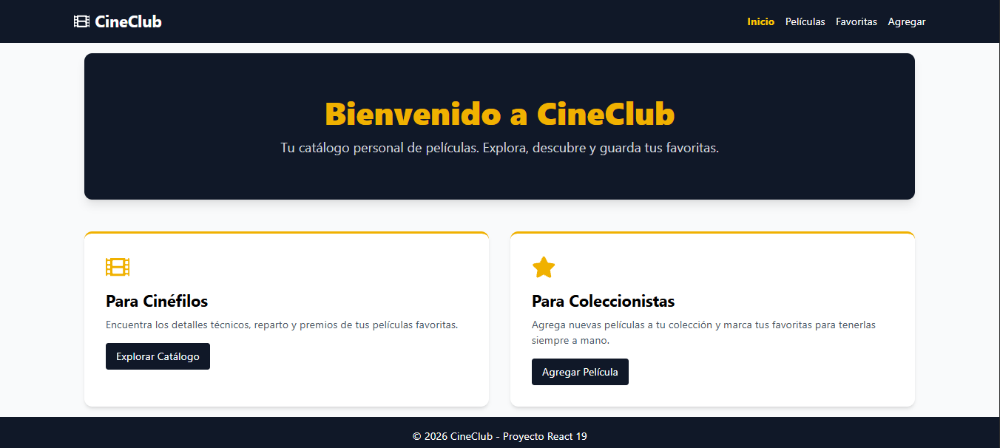

# 🎬 CineClub

CineClub es un catálogo personal de películas hecho con React 19. Permite ver el listado de películas, consultar el detalle de cada una (reparto, premios y director), agregar, editar y eliminar películas, y marcar favoritas. Los datos se guardan en una API REST simulada con json-server.

**Tecnologías:** React 19 · Vite · Tailwind CSS 4 (`@tailwindcss/vite`) · React Router 7 · json-server · react-toastify · react-icons · react-spinners


---

## 🚀 Instalación y ejecución

### Requisitos previos
- [Node.js](https://nodejs.org/) 18 o superior
- npm (viene con Node.js)

### Pasos

1. Clonar el repositorio:
   ```bash
   git clone https://github.com/TU_USUARIO/cineclub.git
   cd cineclub
   ```

2. Instalar las dependencias:
   ```bash
   npm install
   ```

3. Iniciar la API en una terminal:
   ```bash
   npm run server
   ```
   La API queda en `http://localhost:5000/movies`.

4. Iniciar la aplicación en otra terminal:
   ```bash
   npm run dev
   ```
   La app queda en `http://localhost:3000`.

5. Abrir `http://localhost:3000` en el navegador.

> ⚠️ Las dos terminales deben estar abiertas al mismo tiempo. Sin la API, el catálogo muestra un mensaje de error.

### Otros comandos
```bash
npm run lint    # revisa el código
npm run build   # genera la versión de producción en dist/
```

---


## ✅ Requisitos implementados

Leyenda: ✅ cumplido · ⚠️ parcial · ❌ no implementado

### Núcleo (obligatorio)

| RF | Requisito | Estado | Dónde |
|---|---|---|---|
| RF-01 | Layout con `Navbar`, `Outlet` y `ToastContainer`; `NavLink` con enlace activo resaltado | ✅ | `layouts/MainLayout.jsx`, `components/Navbar.jsx` |
| RF-02 | Portada con `Hero` (props con valores por defecto), `Card` con `children` y prop `bg`, 3 películas más recientes y botón "Ver todas" | ✅ | `pages/Home.jsx`, `components/Hero.jsx`, `components/Card.jsx` |
| RF-03 | Listado con `useEffect` + `fetch`, `Spinner`, mensaje de error, estado vacío, `MovieCard` con `key` estable y "Ver más / Ver menos" | ✅ | `pages/Movies.jsx`, `components/MovieCard.jsx` |
| RF-04 | Detalle con `loader`: datos completos, reparto, premios numerados, director y botón "Volver al listado" | ✅ | `pages/MovieDetail.jsx`, `loaders/movieLoader.js` |
| RF-05 | Crear: formulario controlado, `label` con `htmlFor`/`id`, `director` anidado, números convertidos y aviso después de la respuesta del servidor | ✅ | `pages/AddMovie.jsx`, `components/MovieForm.jsx` |
| RF-06 | Editar: formulario precargado; al guardar vuelve al detalle con los cambios | ✅ | `pages/EditMovie.jsx` |
| RF-07 | Eliminar con confirmación y aviso; el listado se actualiza solo | ✅ | `pages/MovieDetail.jsx` |
| RF-08 | Página 404 y `errorElement` para `/movies/9999` | ✅ | `pages/NotFound.jsx`, `pages/ErrorPage.jsx` |
| RF-09 | Diseño responsivo (360 px, 768 px y 1280 px) | ✅ | Navbar y formulario con breakpoints `sm:`/`md:`; tarjetas con la utilidad `grid-cards` (columnas de 180 px que se acomodan solas) |

### Intermedio

| RF | Requisito | Estado | Dónde |
|---|---|---|---|
| RF-10 | Búsqueda por título y filtros por género y clasificación, combinables (estado derivado) | ✅ | `pages/Movies.jsx`, `components/MovieFilters.jsx` |
| RF-11 | Filas dinámicas para agregar y quitar actores y premios, sin mutar el arreglo | ✅ | `components/MovieForm.jsx` |
| RF-12 | Favoritas: corazón en tarjeta y en detalle, página `/favorites` y estrategia justificada | ✅ | `components/FavoriteButton.jsx`, `pages/Favorites.jsx` |
| RF-13 | Validación con mensajes junto a cada campo inválido | ✅ | `components/MovieForm.jsx`, `components/Input.jsx` |
| RF-14 | Paginación con "Anterior / Siguiente" y número de página | ✅ | `pages/Movies.jsx`, `components/Pagination.jsx` |

### Reto React 19 (elegir al menos dos)

| RT | Requisito | Estado | Dónde |
|---|---|---|---|
| RT-01 | Formulario con Action y `useActionState` | ❌ | Ver "Retos de React 19" |
| RT-02 | `SubmitButton` con `useFormStatus` | ❌ | Ver "Retos de React 19" |
| RT-03 | Favorita optimista con `useOptimistic` | ✅ | `components/FavoriteButton.jsx` |
| RT-04 | Datos con `use()` y `<Suspense>` | ❌ | — |
| RT-05 | `<title>` propio en cada página | ✅ | Todas las páginas de `pages/` |
| RT-06 | `ref` como prop en un `Input` reutilizable | ✅ | `components/Input.jsx`, `components/MovieForm.jsx` |

---

## 🧠 Decisiones técnicas


### Cómo manejé las favoritas
Elegí guardar el campo **`favorite` en `db.json` y cambiarlo con PATCH**, en lugar de usar `localStorage`. Las razones:
- **Persisten en el servidor:** se ven igual en cualquier navegador o computador, no solo en el mío.
- **Una sola fuente de verdad:** la película ya trae su estado de favorita, así que no hay que cruzar una lista de ids guardada aparte.
- **PATCH en lugar de PUT:** solo se envía `{ favorite: true/false }` y no el objeto completo, así no hay riesgo de sobrescribir otros campos.

En `Movies.jsx` el corazón usa una **actualización optimista hecha a mano**: el cambio se ve al instante y, si el PATCH falla, se revierte y aparece un toast de error. La página **Favoritas** pide la lista y la filtra con `filter(m => m.favorite)`.

### Retos de React 19
Todavía no he implementado ninguno de los retos RT-01 a RT-06.
<!-- Cuando los hagas, escribe aquí cuáles elegiste y por qué -->


---

## 🛠️ Problemas encontrados y cómo los resolví

1. **Al editar una película se perdían datos (favorita y fecha de creación).**
   El formulario solo envía los campos editables, y PUT reemplaza el objeto completo.
   **Solución:** en `EditMovie.jsx` combino la película original con los cambios: `{ ...movie, ...changes }`.

2. **Portadas rotas cuando la URL era incorrecta o estaba vacía.**
   **Solución:** creé el componente `MoviePoster`, que detecta el fallo con `onError` y muestra un recuadro de respaldo ("Sin portada"). Un `useEffect` reinicia el error cuando cambia la URL, para que la vista previa del formulario funcione mientras se escribe.

3. **Error al abrir una película que no existe (`/movies/9999`).**
   **Solución:** el `movieLoader` lanza `throw new Response(..., { status: 404 })` y la ruta tiene `errorElement: <ErrorPage />`, que muestra un mensaje claro con un enlace de regreso.

---

## 📸 Capturas de pantalla

### Portada


### Listado de películas


### Detalle de película


### Formulario


---

